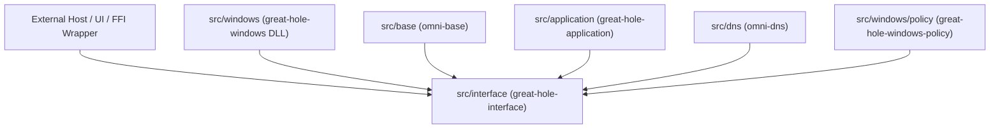

# GreatHole Interface Module — Internal Design

This document describes the internal architecture, dependency boundaries, type-system choices, and build mechanics of the `src/interface` module (`great-hole-interface`).

---

## 1. Architectural Role & Dependency Layering

`src/interface` is the **bottom-most library** in GreatHole's internal dependency graph (`src/CMakeLists.txt` registers `add_subdirectory(interface)` first). It exists to enforce dependency inversion across the codebase:



### Design Invariants
1. **Zero Third-Party Dependencies**: Headers in `src/interface` include only C++23 standard library headers (`<array>`, `<cstdint>`, `<expected>`, `<memory>`, `<optional>`, `<set>`, `<span>`, `<string>`, `<system_error>`, `<unordered_map>`, `<variant>`, `<vector>`). No Boost, Win32 SDK, OmniFiber, or WinDivert headers may leak into `src/interface`.
2. **No Implementation Coupling**: Concrete engine types (`gh::VpnClientMultiChannelSession`, `gh::VpnSplitRule`) are forward-declared in `InterfaceCommonTypes.hpp` and exposed strictly as opaque `std::weak_ptr` handles. This prevents circular dependencies between `interface`, `application`, `dns`, and `windows/policy`, while allowing internal modules to pass strongly typed handles through the public API without casting or integer ID lookup tables.
3. **Synchronous Contract Over Asynchronous Backends**: `PlatformInterface` exposes synchronous C++ methods (returning `std::error_code`, `std::expected`, or values directly) while platform implementations (such as `PlatformImpl` in `src/windows/Interface.cpp`) marshal calls onto their internal Boost.Asio / OmniFiber event loops.

---

## 2. File & Header Organization

| File | Responsibility |
| :--- | :--- |
| `InterfaceCommonTypes.hpp` | Platform-neutral vocabulary types, enums, stats, policy rules, DNS forwarder configs, and callback interfaces (`gh::Interface`). |
| `InterfaceWin32.hpp` | Windows-only data structures and the `PlatformInterfaceWin32` abstract interface. Included conditionally by `Interface.hpp` under `#if defined(_WIN32)`. |
| `Interface.hpp` | Defines `GREAT_HOLE_INTERFACE_API`, declares `PlatformInterface` (inheriting `PlatformInterfaceWin32` on `_WIN32`), and declares `CreatePlatform()`. |
| `Version.h.in` | CMake template generating `${CMAKE_CURRENT_BINARY_DIR}/Version.h` with `constexpr const char* kVersion`. |
| `InterfaceVersion.cpp` | The single translation unit compiled into `great-hole-interface`; defines `PlatformInterface::GetVersion()`. |
| `CMakeLists.txt` | Extracts Git version metadata, configures `Version.h`, and defines `great-hole-interface` and `great-hole-interface-asan` static libraries. |

### Conditional Inheritance (`PlatformInterface` / `PlatformInterfaceWin32`)

Rather than duplicating `PlatformInterface` per OS or scattering `#ifdef _WIN32` blocks inside a single class body, `Interface.hpp` uses conditional public inheritance:

```cpp
class PlatformInterface
#if defined(_WIN32)
    : public PlatformInterfaceWin32
#endif
{ ... };
```

- Keeps cross-platform engine/VPN/DNS methods cleanly separated from Windows-specific policy, ETW process-tree, WinDivert flow, and IP Helper DNS-override APIs.
- Allows non-Windows builds (Linux, Android) to compile `PlatformInterface` without seeing Windows-specific types like `InterfaceLuid` or `ProcessSequence`.
- Both `PlatformInterface` and `PlatformInterfaceWin32` delete copy and move operations and declare `virtual ~...() = default` to enforce polymorphic heap ownership via `std::shared_ptr<PlatformInterface>`.

---

## 3. Type System & ABI Design Decisions

### Opaque `std::weak_ptr` Handles
- `VpnEndpoint = std::weak_ptr<gh::VpnClientMultiChannelSession>`
- `PolicyRule::VpnSplitRoute::Rules = std::weak_ptr<gh::VpnSplitRule>`

Using `std::weak_ptr` instead of raw pointers or `std::shared_ptr` ensures:
- External callers and policy rules cannot accidentally extend the lifetime of internal session or split-rule objects past `RemoveEndpoint()` or `StopEngine()`.
- Internal modules can safely `lock()` the handle on the event-loop thread and gracefully handle expired endpoints (e.g., returning `std::nullopt` from `GetTrafficStats()`).

### Algebraic Types & Zero-Copy Views
- **`std::variant`** models closed sum types (`IpAddress`, `PolicyRule::RoutingAction`, `DnsForwarderCallbacks::DnsQueryResult`), enabling exhaustive `std::visit` dispatch inside `application`, `dns`, and `windows/policy`.
- **`AddressTypes` concept** (`std::same_as<T, Ip4Address> || std::same_as<T, Ip6Address>`) constrains generic address wrappers (`InterfaceAddress<T>`, `DnsInfo<T>`, `IpInterfaceInfo<T>`) to valid IP versions at compile time.
- **Defaulted `<=>`** on `Ip4Address`, `Ip6Address`, `InterfaceAddress`, `DnsEndpoint`, and `DnsInfo` enables direct use in ordered containers (such as `std::set<InterfaceAddress<AddressType>>`) and equality diffing in `InterfaceMonitor`.
- **`std::span`** is used in `StartVpn(...)` and `DnsForwarderCallbacks::OnDnsQueryResult(...)` to avoid unnecessary heap allocations across call boundaries.

### Error Reporting Split
- Cross-platform lifecycle methods (`StartEngine`, `StopEngine`, `StartVpn`, `StopVpn`, `StartDnsForwarder`, `StopDnsForwarder`) return `std::error_code` to integrate directly with `src/base/ErrorCode` and Boost.Asio / `std::errc` error categories.
- Windows-specific policy and DNS-override methods (`AddProcessPolicy`, `LaunchWithPolicy`, `OverrideDnsServers`, `RestoreDnsServers`) return `std::expected<T, std::string>` so platform-specific Win32 / ETW / IP Helper diagnostics can be surfaced as human-readable messages.

### DLL Boundary (`GREAT_HOLE_INTERFACE_API`)
- On Windows, `great-hole-windows` is built as a `SHARED` library (`DLL`) with `GREAT_HOLE_WINDOWS_BUILD_DLL` defined privately.
- Only the factory function `CreatePlatform(DataPlaneCallbacks&)` is marked `GREAT_HOLE_INTERFACE_API`. All other interactions with `PlatformInterface` occur through virtual method dispatch on the returned `std::shared_ptr<PlatformInterface>`, avoiding the need to export internal implementation classes.
- `PlatformInterface::GetVersion()` is a virtual method with a default implementation in `InterfaceVersion.cpp` (statically linked into both the DLL and any consumer linking `great-hole-interface`), allowing the DLL's vtable to report the exact version compiled into the implementation binary.

---

## 4. Build-Time Version Injection

In `src/interface/CMakeLists.txt`:
1. At CMake configure time, `execute_process` runs `git describe --tags` in `${CMAKE_SOURCE_DIR}`.
2. If Git fails or produces an empty string (e.g., shallow clone or source tarball without tags), `GREAT_HOLE_VERSION` defaults to `"unknown"`.
3. `configure_file` substitutes `@GREAT_HOLE_VERSION@` in `Version.h.in` to generate `${CMAKE_CURRENT_BINARY_DIR}/Version.h`.
4. Both `${CMAKE_CURRENT_SOURCE_DIR}` and `${CMAKE_CURRENT_BINARY_DIR}` are exported as `PUBLIC` include directories on `great-hole-interface` and `great-hole-interface-asan`.

> [!NOTE]
> Because `git describe --tags` runs during CMake configuration rather than at build time, changing Git tags without re-running CMake will not update `Version.h`.

---

## 5. Implementation Notes & Existing Quirks

When modifying or consuming `src/interface`, be aware of the following existing details in the headers:
- **`TrafficStats::OnBackword`**: The backward traffic counter mutator is spelled `OnBackword` (not `OnBackward`). Renaming it requires updating all callers in `src/application` and `src/core`.
- **`ProcessInfo::ParentProcess`**: Declared as `std::optional<ProcessSequence> ParentProcess{0};`, which default-initializes to a *present* optional containing `0` rather than `std::nullopt`. Producers representing a root/unknown parent should explicitly assign `std::nullopt` when appropriate.
- **Callback Lifetimes**: `CreatePlatform(DataPlaneCallbacks&)` and `StartDnsForwarder(..., DnsForwarderCallbacks&)` accept non-owning references. Both callback base classes disable copy/move semantics to prevent accidental slicing or relocation while registered with asynchronous worker threads.
